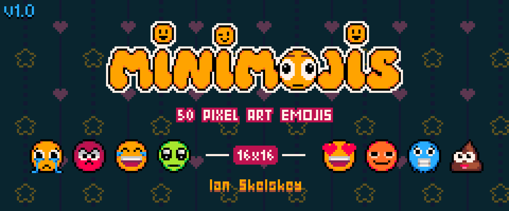
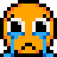
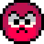
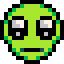
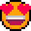
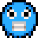
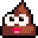

<p align="center">
  
</p>

# Minimojis — Free Samples

Eight free emojis from **[Minimojis](https://ianskelskey.itch.io/minimojis)**, a pack of 50
pixel-art emoticons drawn on a 16×16 canvas. They're hosted here so you can drop them straight
into GitHub comments, issues, pull requests and READMEs.

<p align="center">
  &nbsp;
  &nbsp;
  &nbsp;
  &nbsp;
  &nbsp;
  &nbsp;
  &nbsp;
  
</p>

## Using them

Paste this into any comment, swapping in the name of the emoji you want:

```html

```

That gives you a 32px emoji that stays crisp. For one that sits inline with your text, use the
32×32 file at half size instead:

```html

```

| | Name | | Name |
|:-:|---|:-:|---|
|  | `crying_face` |  | `heart_eyes` |
|  | `enraged_face` |  | `stoned_face` |
|  | `tears_of_joy` |  | `cold_face` |
|  | `alien` |  | `pile_of_poo` |

### Why the sizes?

GitHub strips CSS from comments, so there's no way to tell the browser to keep pixel art sharp.
Any image shown at a size other than its own gets smoothed and goes blurry. Every emoji here
comes pre-scaled, nearest-neighbor, in three sizes:

- **16x16/** — the original
- **32x32/** — 2×, shown at `width="16"` for inline use
- **64x64/** — 4×, shown at `width="32"` for reactions

Showing each file at exactly half its size keeps it crisp on both standard and high-DPI screens.

## Want all 50?

The full pack has 42 more, including the happy ones, the deadpan ones, a few homages, a
Halloween set and some symbols, plus a spritesheet and enlarged copies up to 128×128.

**[Get Minimojis on itch.io →](https://ianskelskey.itch.io/minimojis)**

I'd like to see the pack grow past 100. If there's an emoji you'd use that isn't in it yet,
[open an issue](https://github.com/ianskelskey/minimojis/issues) or leave a comment on the itch page.

## License

The eight samples in this repo are free to use in comments, issues, READMEs, and personal and
commercial projects. Credit is appreciated: **Minimojis by Ian Skelskey**.

Please don't redistribute them as an asset pack or emoji set of your own.

Hand-drawn, no AI.
